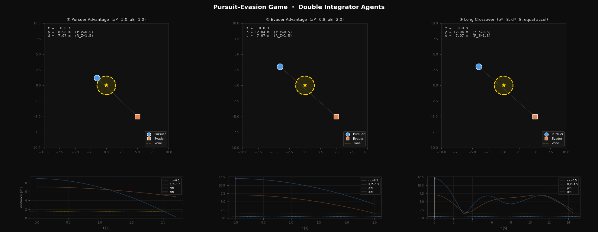

# Pursuit-Evasion Game Dynamics: Analysis

CDS 232 (Nonlinear Dynamics) final project, Caltech, Winter 2026. Individual project by Taekyung (TK) Lee.

A pursuer tries to intercept an evader before the evader reaches a protected zone. Both agents are planar double integrators with bounded acceleration and sigmoid-blended feedback laws, so the closed loop is an eight-dimensional nonlinear system. The project applies the analysis tools of the course to this game: existence and uniqueness, sensitivity, stability, robustness and safety.



## What was shown

| Tool | Result |
|---|---|
| Lipschitz constant, Picard–Lindelöf | The vector field is locally Lipschitz on the game domain, so trajectories exist and are unique; Picard iterates converge to the RK45 solution |
| Continuous dependence | The bound on initial-condition and parameter perturbations holds when L is computed along the trajectory; the domain-wide bound is valid but too loose to use |
| Linearization, Hartman–Grobman | With a smooth tanh pursuer law and the evader frozen, the defender equilibrium is a stable spiral: λ = −0.5 ± 0.354j, −0.5 ± 0.102j |
| Lyapunov function | V = δzᵀPδz with AᵀP + PA = −I; region-of-attraction estimate V ≤ 129 |
| Input-to-state stability | Bounded disturbances on the pursuer's acceleration give a bounded steady-state deviation (about 4μ for small μ) |
| Barrier function | B = ρ − r_c is not globally forward invariant, but the evader stays safe up to a pursuer-to-evader acceleration ratio of about 2.48 |

## Repository structure

```
CDS232/
├── pursuit_evasion/          Python package
│   ├── params.py             game parameters (report Table 1), initial conditions, equilibrium
│   ├── dynamics.py           control laws, closed-loop vector field, RK4/RK45 simulation
│   ├── analysis.py           Lipschitz, Picard, continuous dependence, linearization, Lyapunov/ROA, ISS, barrier
│   └── scenarios.py          example games for the figures and animation
├── scripts/
│   ├── run_analysis.py       prints the key numbers next to the report's values
│   ├── make_figures.py       regenerates the figures into outputs/
│   └── animate.py            renders outputs/pursuit_evasion.gif
├── outputs/                  figures and animation produced by the scripts
├── report/                   final report (PDF)
├── slides/                   presentation
├── figures/                  the report's figures, fig01–fig16, numbered as in the report
└── media/                    animations and a one-page results overview
```

## Setup

```bash
git clone <this repo>
cd CDS232
python3 -m venv .venv && source .venv/bin/activate
pip install -r requirements.txt
```

## Usage

```bash
python scripts/run_analysis.py   # key numbers, about 1 s
python scripts/make_figures.py   # figures into outputs/, a few seconds
python scripts/animate.py        # outputs/pursuit_evasion.gif, about 20 s
```

## Media

- `media/pursuit_evasion_double_integrator.gif`: the three outcomes in the report's model (capture, zone breach, draw)
- `outputs/pursuit_evasion.gif`: example games generated by `scripts/animate.py`
- `media/results_overview.jpg`: one-page summary of the results
- `media/checkpoints/`: animations from earlier project checkpoints, which used a simpler kinematic model

## Reference

CDS 232: Nonlinear Dynamics and Control. California Institute of Technology.
